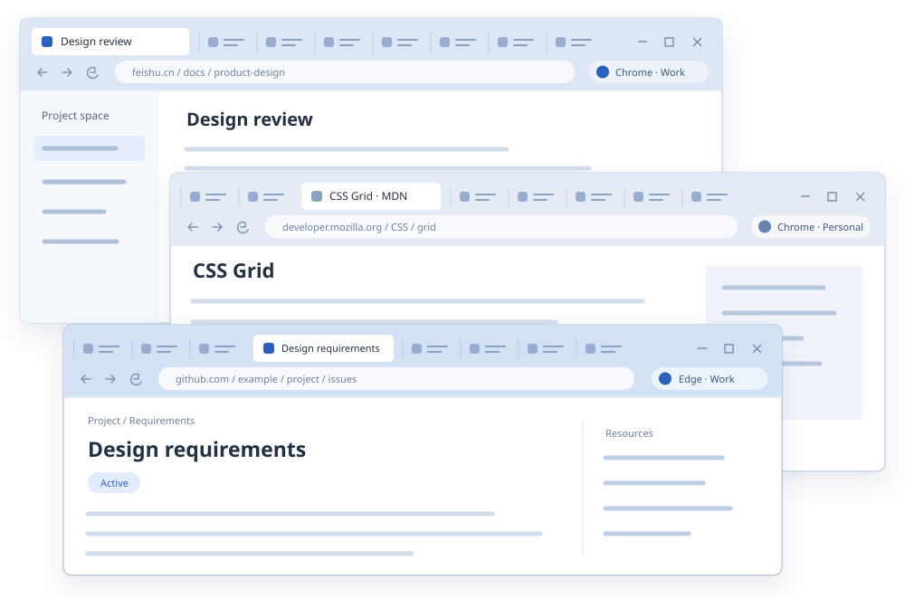
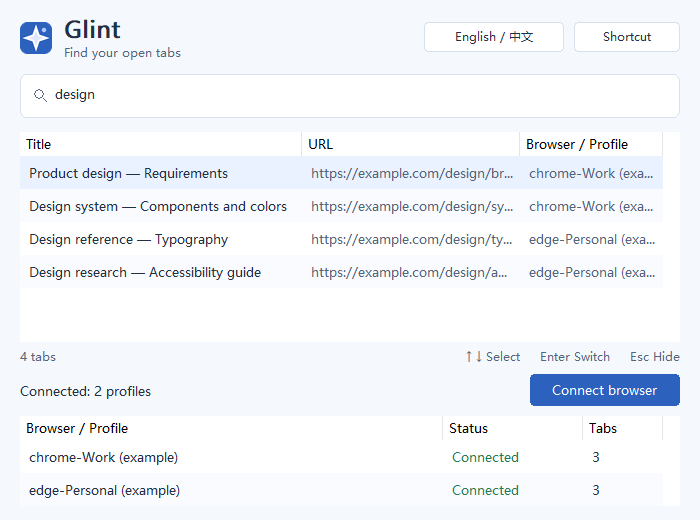
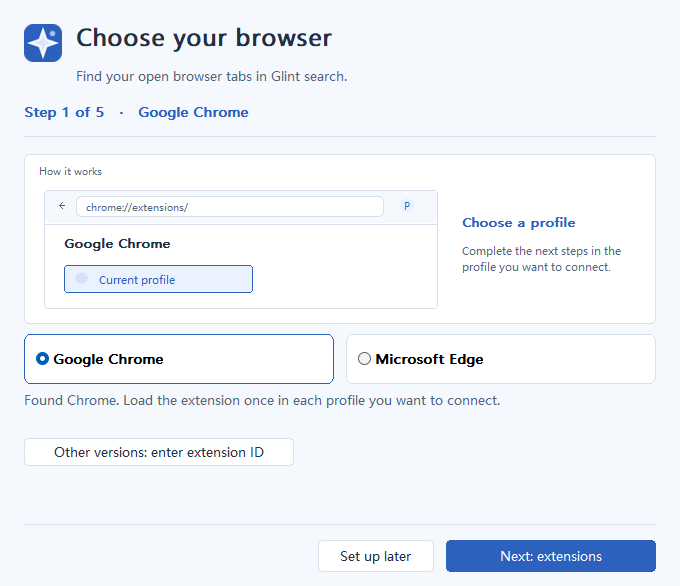
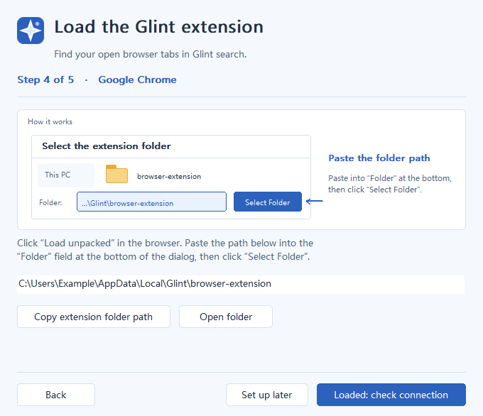
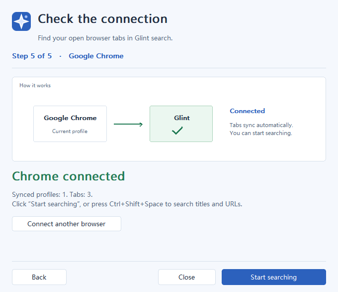

<p align="center">
  
</p>

# Glint · Cross-browser tab search

Search open Chrome and Edge tabs by title or URL on Windows 10/11 x64.

[](https://github.com/new-sailfish/glint/releases/latest)


[](https://github.com/new-sailfish/glint/actions/workflows/build.yml)

[**Download Glint.exe**](https://github.com/new-sailfish/glint/releases/latest/download/Glint.exe) · [Project website](https://new-sailfish.github.io/glint/) · [中文](README.zh-CN.md) · [User guide](docs/user-guide.md)

## Project background

A page may be open in Chrome or Edge, in another window, or under a different
work or personal profile. Remembering part of its title is often easier than
remembering where it is. Switching between windows to inspect their tab bars
adds another step to finding it.

Glint collects the open tabs from the browser profiles you connect into one
Windows search window. Search for a title or URL, then return directly to the
existing tab and its window.



## Features and workflow

Press **Ctrl+Shift+Space**, type part of a title or URL, select a result and press
**Enter**. Glint activates that tab and brings its browser window forward,
restoring the window if it is minimized.



*Native interface render with sample tab data. [Image provenance](docs/assets/README.md).*

| Capability | Behavior |
| --- | --- |
| Search across profiles | One result list for connected Chrome and Edge profiles, including their separate windows. |
| Keep results current | Tab creation, closure, title and URL changes, and moves between windows update the index. |
| Use the keyboard | Global shortcut, arrow-key navigation, Enter to activate, and Esc to hide. The shortcut is configurable. |
| See connection status | A profile table shows connection state and tab counts. Optional profile labels distinguish work and personal browsers. |
| Work locally | Extensions send tab metadata through a local bridge. The desktop search index stays in memory and is rebuilt after restart. |

The extension reads tab titles, URLs, IDs and activation state. It does not
inject scripts or read page contents. Search covers open tabs supplied by
connected profiles; it does not search bookmarks or browsing history.

## Install, configure and use

### Language

Glint supports English and Chinese. By default, a Chinese Windows display language selects Chinese; every other display language selects English. Choose **English / 中文** in the search window (or **Language / 语言** in the tray menu) to select **Follow system**, **English**, or **中文**. Your selection is saved and applies immediately.

All connected browser extensions follow the desktop language immediately, including when **Follow system** is selected. Reconnecting extensions receive the current language; offline extensions keep the last received language. Before their first connection, extensions follow the browser UI language. The product website keeps its own language selector. Browser-managed extension names and descriptions follow the browser language. Tab titles, URLs, and profile labels remain unchanged.

### Download

Download [**Glint.exe**](https://github.com/new-sailfish/glint/releases/latest/download/Glint.exe),
save it somewhere you will keep, and run it. Requirements are **Windows 10/11
x64** and **Chrome or Edge 105+**. No administrator access or separate Visual C++
runtime installation is needed.

The EXE contains the browser extension and prepares it automatically. The
optional [full ZIP](https://github.com/new-sailfish/glint/releases/latest/download/Glint-win-x64.zip)
also includes extension files and documentation.

Glint checks for newer versions and downloads them in the background. Use
**Software updates** in the tray menu to view progress or disable automatic
downloads. Choose **Restart and update** when ready; ordinary exit does not
install an update. Reload the browser extension when prompted after its files
change. See the [update guide](docs/user-guide.md#updates-and-older-installations).

### Connect each browser profile

Click **Connect browser** in Glint and follow its five stages:

1. **Choose Chrome or Edge.** Click **Next: extensions**. Glint prepares
   `%LOCALAPPDATA%\Glint\browser-extension` and registers the local bridge for
   that browser under your Windows account. The bundled extension needs no ID entry.
2. **Open the extensions page.** Click **Open browser and copy address**. Select the
   intended browser profile, then press **Ctrl+L → Ctrl+V → Enter** to open
   the copied address: `chrome://extensions/` or `edge://extensions/`.
3. **Enable Developer mode.** In Chrome the switch is at the upper right; in
   Edge it is in the left sidebar. Return to Glint and continue.
4. **Load the extension.** Click **Copy extension folder path** in Glint, then **Load
   unpacked** in the browser. Paste the copied path into the folder chooser's
   **Folder** field and click **Select Folder**. Select `browser-extension`,
   the folder containing `manifest.json`, rather than its parent directory.
5. **Confirm synchronization.** Return to Glint and click **Loaded: check connection**.
   When the browser is shown as **connected** with the profile and tab counts, click **Start searching**.

| Choose a browser | Load the extension folder | Confirm the connection |
| --- | --- | --- |
|  |  |  |

**Repeat the browser loading step in every profile whose tabs you want to
search.** Installation currently uses **Load unpacked**; no browser-store
installation is provided. Keep the extracted `browser-extension` directory
because the browser loads the extension from it. The page address goes into
the browser address bar; the folder path goes into the folder chooser.

If the browser does not open, open it yourself and enter its extensions-page
address. For connection errors, use **Connection help** in the guide or follow the
[troubleshooting steps](docs/user-guide.md#connection-troubleshooting).

### Search and configure the shortcut

| Key or action | Result |
| --- | --- |
| `Ctrl+Shift+Space` | Open search using the default global shortcut. |
| Type a title or URL fragment | Filter connected tabs. |
| `↓` in the search field | Select the first result. |
| `↑` on the first result | Return to the search field, retaining its text and caret. |
| `Enter` / `Esc` | Activate the selected tab / hide search. |
| Tray → **Configure shortcut** | Record and save a different shortcut. |


Click the Glint icon in the browser toolbar to view connection status or set an
optional profile label. Closing the search window keeps Glint in the tray.
**Exit Glint** in the tray menu stops the desktop and hotkey; browser-managed
bridges wait for the next launch. See the [user guide](docs/user-guide.md) for
shortcut rules, lifecycle details, upgrades, manual registration and uninstalling.

## Development

Glint uses **C++20 and Win32** for the desktop application and a shared
**Manifest V3 extension** for Chrome and Edge. Build with PowerShell 7 in a
VS 2022 x64 developer environment, CMake 3.21+ and Node.js 22+. The extension
uses Node's built-in test runner and needs no package installation.


Each browser profile runs the same extension. A browser-managed
`GlintBridge.exe` connects it to the desktop application through Native
Messaging and a current-user Windows named pipe. Glint prepares the bridge from
the downloaded EXE. See the [architecture](docs/design.md) and
[protocol](docs/protocol.md) for implementation details.

```powershell
cmake --preset release
cmake --build --preset release --parallel
.\scripts\test-changed.ps1
```

Before handing over a release, stop the desktop and run the full validation and
packaging gate:

```powershell
.\scripts\check-release.ps1
```

The usable release is `dist/Glint.exe`; the gate also produces
`Glint-win-x64.zip` and a version/hash manifest. The
[development guide](docs/development.md) covers test selection, version
allocation, CI, packaging and source layout. See also the
[extension documentation](extension/README.md), [design](docs/design.md) and
[wire protocol](docs/protocol.md).
