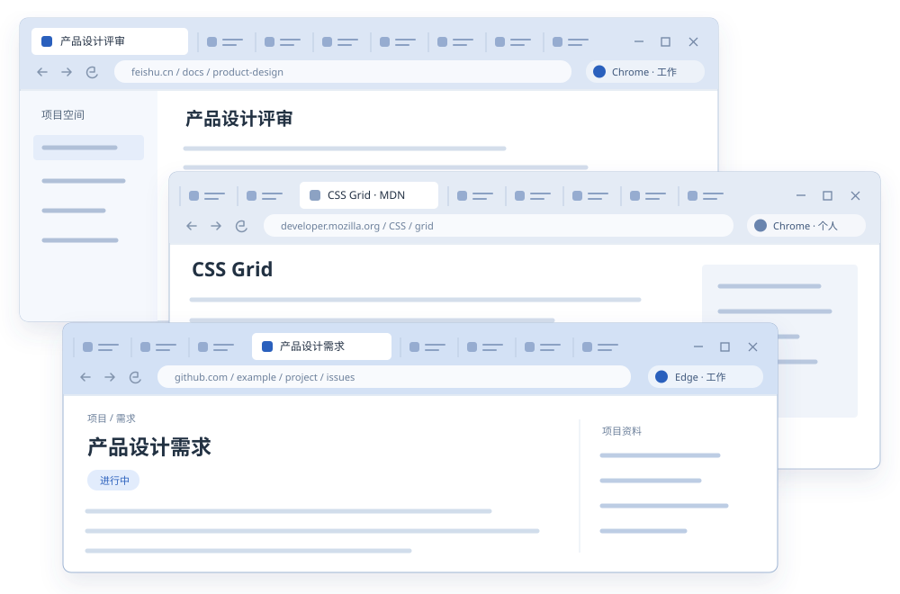
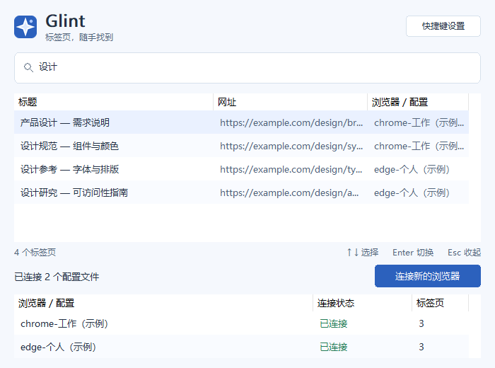
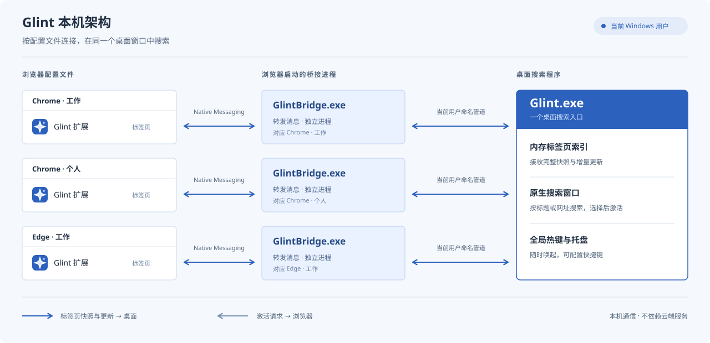

<p align="center">
  
</p>

# Glint · 跨浏览器标签页搜索

在 Windows 10/11 x64 上，按标题或网址搜索 Chrome、Edge 中已打开的标签页。

[](https://github.com/new-sailfish/glint/releases/latest)


[](https://github.com/new-sailfish/glint/actions/workflows/build.yml)

[**下载 Glint.exe**](https://github.com/new-sailfish/glint/releases/latest/download/Glint.exe) · [项目网站](https://new-sailfish.github.io/glint/) · [English](README.md) · [详细使用指南（英文）](docs/user-guide.md)

## 项目背景

同一个工作过程里，页面可能分散在 Chrome 和 Edge、多个窗口，以及工作和个人配置文件中。
记得页面标题的一部分，却不记得它开在哪个窗口，是很常见的情况。逐个切换窗口、查看标签栏，
会打断原本正在做的事。

Glint 把已连接配置文件中的标签页汇集到一个 Windows 搜索窗口。输入标题或网址片段，
即可找到并回到原来的标签页和浏览器窗口。



## 功能与工作方式

按 **Ctrl+Shift+Space** 呼出搜索，输入标题或网址片段，用方向键选择结果，按 **Enter**
切换。Glint 会激活对应标签页并将所在窗口切到前台；窗口已最小化时会先恢复。



*原生界面离屏渲染，标签页使用示例数据。[图片来源说明](docs/assets/README.md)。*

| 功能 | 使用方式 |
| --- | --- |
| 跨浏览器、跨配置文件搜索 | 在同一列表中查看已连接 Chrome、Edge 配置文件各窗口里的标签页。 |
| 持续同步标签页 | 新建、关闭、标题和网址变化，以及窗口间移动，都会更新搜索索引。 |
| 键盘操作 | 全局热键呼出、方向键选择、回车切换、Esc 隐藏；热键可以自定义。 |
| 查看连接状态 | 状态表显示配置文件连接状态和标签页数量；可设置名称区分工作、个人等用途。 |
| 本机通信 | 扩展通过本机通信桥发送标签页元数据；桌面搜索索引只保存在内存中，重启后重新同步。 |

扩展读取标签页的标题、网址、ID 和激活状态，不注入脚本，也不读取网页正文。
搜索范围是已连接配置文件中打开的标签页，不包括书签和浏览历史。

## 安装配置与使用

### 下载运行

下载 [**Glint.exe**](https://github.com/new-sailfish/glint/releases/latest/download/Glint.exe)，
放在准备长期保留的位置并运行。系统要求为 **Windows 10/11 x64**、**Chrome 或 Edge 105+**，
无需管理员权限，也无需另装 Visual C++ 运行库。

浏览器扩展已内嵌在 EXE 中，由程序自动准备。
[完整 ZIP 包](https://github.com/new-sailfish/glint/releases/latest/download/Glint-win-x64.zip)
额外提供扩展文件和说明文档，可按需下载。

### 按五步引导连接浏览器

在 Glint 点击 **连接新的浏览器**：

1. **选择 Chrome 或 Edge。** 点击 **下一步：打开扩展页**。Glint 会准备
   `%LOCALAPPDATA%\Glint\browser-extension`，并为所选浏览器注册当前用户的本机通信桥。
   使用内置扩展时无需填写 ID。
2. **打开扩展管理页。** 点击 **打开浏览器并复制页面地址**。在浏览器中选择要接入的
   配置文件，按 **Ctrl+L → Ctrl+V → 回车** 进入复制的地址：
   Chrome 为 `chrome://extensions/`，Edge 为 `edge://extensions/`。
3. **开启开发者模式。** Chrome 的 **开发者模式** 开关在页面右上角；Edge 的
   **开发人员模式** 开关在左侧。开启后回到 Glint，继续下一步。
4. **加载扩展文件夹。** 在 Glint 点击 **复制扩展文件夹路径**，再到浏览器点击
   **加载已解压的扩展程序**（Chrome）或 **加载解压缩的扩展**（Edge）。将路径粘贴到
   文件夹选择窗口底部的 **文件夹** 输入框，直接点击 **选择文件夹**。
   应选择包含 `manifest.json` 的 `browser-extension` 文件夹，不要选择上一级目录。
5. **确认同步成功。** 回到 Glint，点击 **已加载，检查连接**。
   页面显示 **已连接**、配置文件和标签页数量后，点击 **开始搜索**。

| 选择浏览器 | 加载扩展文件夹 | 确认连接 |
| --- | --- | --- |
|  |  |  |

**每个需要搜索的浏览器配置文件都要分别加载扩展。** 当前使用“加载已解压的扩展程序”安装，
没有浏览器商店安装入口。浏览器会从释放后的目录运行扩展，请保留 `browser-extension` 目录。
两次复制的用途不同：页面地址粘贴到浏览器地址栏，文件夹路径粘贴到文件夹选择窗口。

如果浏览器未自动打开，请自行打开并输入对应的扩展管理页地址。连接失败时，可在向导中点击
**连接遇到问题**；进一步排查见[详细使用指南（英文）](docs/user-guide.md#connection-troubleshooting)。

### 搜索与快捷键配置

| 按键或操作 | 作用 |
| --- | --- |
| `Ctrl+Shift+Space` | 使用默认全局热键呼出搜索。 |
| 输入标题或网址片段 | 筛选已连接的标签页。 |
| 搜索框中按 `↓` | 选择第一条结果。 |
| 第一条结果上按 `↑` | 返回搜索框，保留文字和光标位置。 |
| `Enter` / `Esc` | 激活选中标签页 / 隐藏搜索。 |
| 托盘 → **配置全局热键** | 录入并保存新的快捷键。 |


点击浏览器工具栏中的 Glint 图标，可查看连接状态并设置配置文件名称。
关闭搜索窗口后，程序仍在托盘运行。从托盘选择 **退出 Glint** 会停止桌面程序和热键；
浏览器管理的通信桥会等待下次启动。完整的快捷键规则、进程生命周期、旧版升级、
手动注册和卸载方法见[详细使用指南（英文）](docs/user-guide.md)。

## 开发与构建

桌面端使用 **C++20 和 Win32**，Chrome 与 Edge 共用 **Manifest V3 扩展**。
在 VS 2022 x64 开发者环境中使用 PowerShell 7、CMake 3.21+ 和 Node.js 22+。
扩展采用 Node 内置测试运行器，无需安装第三方包。



每个浏览器配置文件使用同一份扩展。浏览器管理的 `GlintBridge.exe` 通过 Native Messaging
和当前 Windows 用户的命名管道连接桌面程序。通信桥由下载的 EXE 自动准备。
实现细节见[设计说明](docs/design.md)和[通信协议](docs/protocol.md)。

```powershell
cmake --preset release
cmake --build --preset release --parallel
.\scripts\test-changed.ps1
```

交付 Release 前，退出正在运行的桌面程序，再执行完整验证与打包：

```powershell
.\scripts\check-release.ps1
```

可用程序位于 `dist/Glint.exe`，同时生成 `Glint-win-x64.zip` 和版本、哈希清单。
选测、版本号分配、CI、打包和源码结构见[开发指南（英文）](docs/development.md)。
另见[扩展说明](extension/README.md)、[设计说明](docs/design.md)和[通信协议](docs/protocol.md)。
