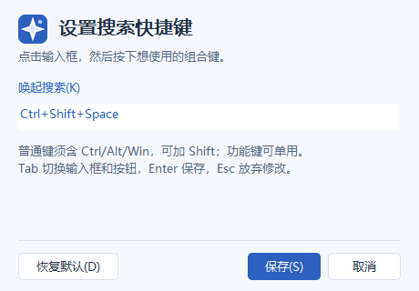

# Glint user guide

[English overview and installation](../README.md) · [中文概览与安装](../README.zh-CN.md) · [Development guide](development.md)

This guide covers everyday controls, connection repair, updates and removal.
For first-time setup, follow the [five-stage installation guide](../README.md#connect-each-browser-profile).
Chinese button names below match the labels in the current application.

## Browser profiles and connection status

Load and enable the extension in every Chrome or Edge profile whose tabs should
be searchable. Each profile has its own connection; installing the extension in
a work profile does not expose tabs in a personal profile.

The desktop table lists profiles as `chrome-{label}` or `edge-{label}`, with
their connection state and synchronized tab count. Unnamed profiles receive a
number for the current desktop session. A profile seen during that session stays
in the table as disconnected after its browser closes, without stale tab counts.
Reconnecting updates the existing row.

Click the Glint icon in the browser toolbar to open the status panel. If the
icon is not pinned, open it through the browser's extensions menu. Expand
**配置文件名称** to assign a local label such as “Work” or “Personal”. Glint cannot
read the browser's own profile display name. The full panel is also available
under the extension's **Details → Extension options** entry.

Installing or updating the extension does not open an extra browser tab.
Closing its popup does not disconnect it. Once setup is complete, browser and
desktop restarts automatically reconnect and rebuild the tab index.

### Extension folder selection

The default extension folder is:

```text
%LOCALAPPDATA%\Glint\browser-extension
```

Glint prepares it from the EXE's five extension runtime files and four icon
assets. The browser loads the unpacked extension from that directory, so keep it
on disk. There is no browser-store installation in this release.

During **Load unpacked**, paste the complete copied path into the chooser's
bottom **Folder** field and click **Select Folder** directly. The selected folder
must contain `manifest.json`. If you have already entered `browser-extension`
and the chooser will not accept the current folder, go up one level, single-click
`browser-extension` and then click **Select Folder**.

The guide has two copy actions: **打开浏览器并复制页面地址** copies an address for
the browser address bar; **复制扩展文件夹路径** copies a directory for the folder
chooser. If browser launch fails, open the target profile yourself and enter
`chrome://extensions/` or `edge://extensions/`.

## Search and keyboard controls

Search matches a title or URL fragment in the currently synchronized open tabs.
Selecting a result activates that tab in its current window. Minimized windows
are restored; maximized windows keep their state. Glint checks the resulting
focus and reports activation failure if the browser cannot bring the target
forward.

| Context | Key | Behavior |
| --- | --- | --- |
| Anywhere | `Ctrl+Shift+Space` by default | Open Glint search. |
| Search field | `↓` | Select and scroll to the first result. An empty list keeps focus in the field. |
| Search field | `↑` | Keep focus in the field. |
| First result | `↑`, `Home` or `PageUp` | Return to the search field, preserving text and caret. |
| Other results | Arrow keys, `Home` and `PageUp` | Use normal list navigation. |
| Selected result | `Enter` | Activate the tab. |
| Search window | `Esc` | Hide search. |

`Fn+↑` also returns from the first result when the keyboard maps it to `Home`
or `PageUp`. Those keys keep their usual editing behavior in the search field.

### Customize the global shortcut

Right-click Glint's tray icon and choose **配置全局热键**. Focus the recording
field, press your desired combination and click **保存**. For example, use
`Ctrl+Alt+K`.

- Letters, numbers and other ordinary keys require Ctrl, Alt or Win. Shift may
  be added.
- F1–F24 can be used alone or with modifiers, including Shift. F12 is reserved.
- **恢复默认** restores the default in the recording field; **保存** commits it.
- Tab and Shift+Tab move between the field and buttons. Enter saves. Esc closes
  the settings window and discards unsaved changes.



Saving checks the combination with Windows before replacing the active
shortcut. An occupied or reserved combination shows an inline error and leaves
the previous shortcut working. A failed save or cancellation also keeps the old
configuration. Settings persist for the current Windows user, including choices
migrated from older shortcut presets.

## Start, hide and exit

Closing or hiding the search window leaves the desktop running in the tray.
Choose **退出 Glint** from the tray menu to stop the desktop `Glint.exe`,
its search window and its global shortcut.

A connected browser profile owns a separate `GlintBridge.exe` process.
After desktop exit, that bridge waits for the desktop to start again. It does not
launch a desktop window or repeatedly start new bridge processes. Starting
Glint reconnects automatically and requests a fresh tab snapshot; the tab index
is not saved to disk.

The bridge is a copy of the downloaded executable, prepared automatically under
a SHA-256-versioned directory in the current user's application data. It needs
no separate download. Closing the corresponding browser or disabling its Glint
extension ends that bridge's connection and process. To stop all Glint background
processes, disable the extensions and exit the desktop.

## Connection troubleshooting

Reopen setup through **连接新的浏览器** in the main window,
**连接新的浏览器（安装引导）** in the tray menu, or the command below, run from the
folder containing the EXE:

```powershell
.\Glint.exe --setup
```

| Status or symptom | Action |
| --- | --- |
| **已连接 Glint** in the extension | The bridge has confirmed its desktop connection. Return to Glint and check the profile and tab counts to confirm synchronization. |
| **扩展需要重新加载** | Reload the existing Glint card in the browser's extensions manager, then reopen the panel. The popup and background worker need matching code and status fields. |
| **Glint 未运行，等待自动连接** | Start `Glint.exe`. The existing bridge reconnects and resynchronizes automatically; no reload or retry is required. |
| **尚未建立桥接通道** | Use setup for the current browser to register the host. Read the browser's displayed error, then click **重试连接** after repair. Automatic retries back off to at most 30 seconds. |
| A profile or its tabs are missing | Check that Glint is loaded and enabled in that exact browser profile, and inspect its toolbar status panel. |
| The desktop guide stays **未连接** | Confirm that the selected browser has sent its tabs. A native port opening, registration succeeding, or another browser connecting does not complete this step. |
| `Specified native messaging host not found` persists | The browser has not found the registered local host. Preserve the full error for diagnosis; repeatedly entering the same ID is unlikely to resolve it. |

Normal desktop startup refreshes embedded extension files and valid existing
host registrations while preserving their allowed origins. Moving the EXE does
not change the bundled extension's identity. If refresh fails, Glint reports it;
rerun setup to repair the registration.

### Repair an extension with a different ID

On the final connection page, click **连接遇到问题**. Paste the extension's full
options-page URL, such as `chrome-extension://…/options.html`, or its ID.
Click **保存 ID 并重试**, then **重试连接** in the extension panel. A standalone
ID must contain exactly 32 lowercase characters from `a` through `p`.
The repair updates only the selected browser's registration; search becomes
available after the desktop receives a real tab snapshot.

The browser-selection page also offers **其他版本：手动填写扩展 ID** for another
extension identity. This is a registration option, not a browser-store installer.

The bundled extension's public-key ID is the same in Chrome and Edge:

```text
pecljnjkgandbbelbajkppllibpehhpe
```

Its manifest contains the RSA public key that fixes this ID across machines
and directories, with no signing private key. Unpacked extensions without that
key can have a directory-derived ID. Use the actual ID for other versions.

Automatic setup permits exactly two origins: the bundled public-key ID and the
legacy path-derived ID for `%LOCALAPPDATA%\Glint\extension`. It uses no
wildcards and does not allow arbitrary extensions. Advanced and command-line
registration permit only the single supplied ID for each browser.

### Command-line registration

From the directory containing `Glint.exe`, register the bundled extension for
both browsers:

```powershell
.\Glint.exe --register --chrome-id pecljnjkgandbbelbajkppllibpehhpe --edge-id pecljnjkgandbbelbajkppllibpehhpe
```

Supply only `--chrome-id` or `--edge-id` to update that browser and preserve
the other's registration. Replace the ID when registering another extension.
This writes manifests under `%LOCALAPPDATA%\Glint` and current-user keys at:

```text
HKCU\Software\Google\Chrome\NativeMessagingHosts\com.glint.host
HKCU\Software\Microsoft\Edge\NativeMessagingHosts\com.glint.host
```

No administrator rights are needed. Registration points to the prepared
`GlintBridge.exe`. For fully manual setup, the
[Chrome](../extension/host-manifest.chrome.json) and
[Edge](../extension/host-manifest.edge.json) manifests are templates; replace
their executable paths and extension IDs before registering them.

## Updates and older installations

Exit the old desktop through the tray, start the updated `Glint.exe`, and click
**Reload** on the existing Glint card in each browser profile's extensions
manager to activate refreshed extension code. Normal startup refreshes the
bundled files. Keep an existing stable extension path, including
`dist\browser-extension` if that is where your browser already loads it.

Desktop product versions and browser extension versions are independent. The
following notes refer to **extension versions**:

| Upgrade | Required action and relevant change |
| --- | --- |
| 0.1.6 | Reload each existing card for the unified icon and refreshed status panel. The ID and existing path stay unchanged. |
| 0.1.5 | Reload each card for the activation handoff fix, which checks stable focus and retries briefly if focus is lost. |
| 0.1.4 | Reload each card for desktop-confirmed status. A stale worker may show **扩展需要重新加载**. Later desktop restarts reconnect automatically. |
| 0.1.3 | Reload each card once for automatic reconnection across desktop restarts. |
| 0.1.2 | Reload for window-focus and tab-closure synchronization fixes. Existing `dist\browser-extension` installations keep their path and ID. |
| 0.1.1 or an installation using the old `Glint\extension` directory | Run setup and load the new `%LOCALAPPDATA%\Glint\browser-extension` directory once in every profile. |

When migrating from the old directory, load the new directory directly if the
Glint card has disappeared. A copy with the same fixed public-key ID updates its
source path without first being removed. Glint preserves the old
`%LOCALAPPDATA%\Glint\extension` directory without overwriting or deleting it.

After migration, close and reopen the browser normally and check that the card
remains installed. An older copy without the public key may be removed if it
still appears; removing it can reset its optional profile label. Copies loaded
from other directories can be registered using their actual options-page URL
through the repair flow.

## Permissions and stored data

The extension requests `tabs`, `nativeMessaging` and `storage`. It reads tab
metadata, including title, URL, tab/window IDs and activation state, without
injecting scripts or reading page contents. Local extension storage holds its
profile identity and optional label. The extension UI loads no external scripts,
fonts or other dependencies. The desktop tab index is memory-only and is rebuilt
from current tabs after reconnecting.

## Uninstall

1. Remove Glint from every Chrome and Edge profile where it was installed.
2. From the directory containing the EXE, remove both browsers' current-user
   Native Messaging registrations:

   ```powershell
   .\Glint.exe --unregister
   ```

3. Exit Glint from the tray, then delete the program files and
   `%LOCALAPPDATA%\Glint` directory.
